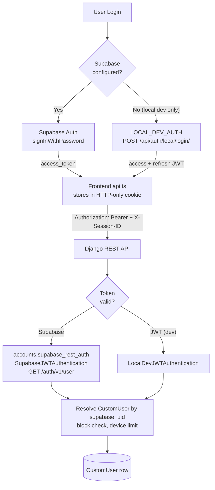
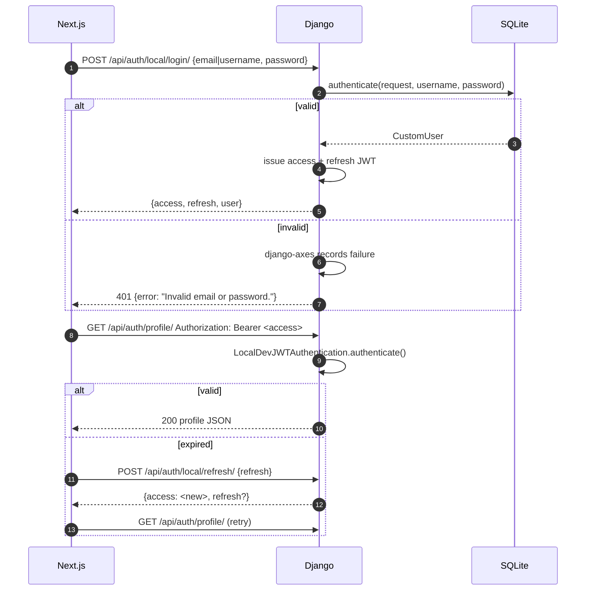
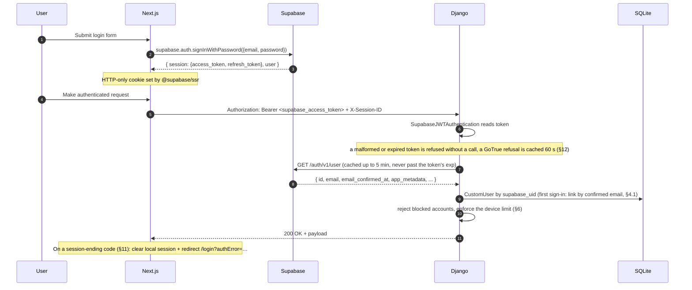
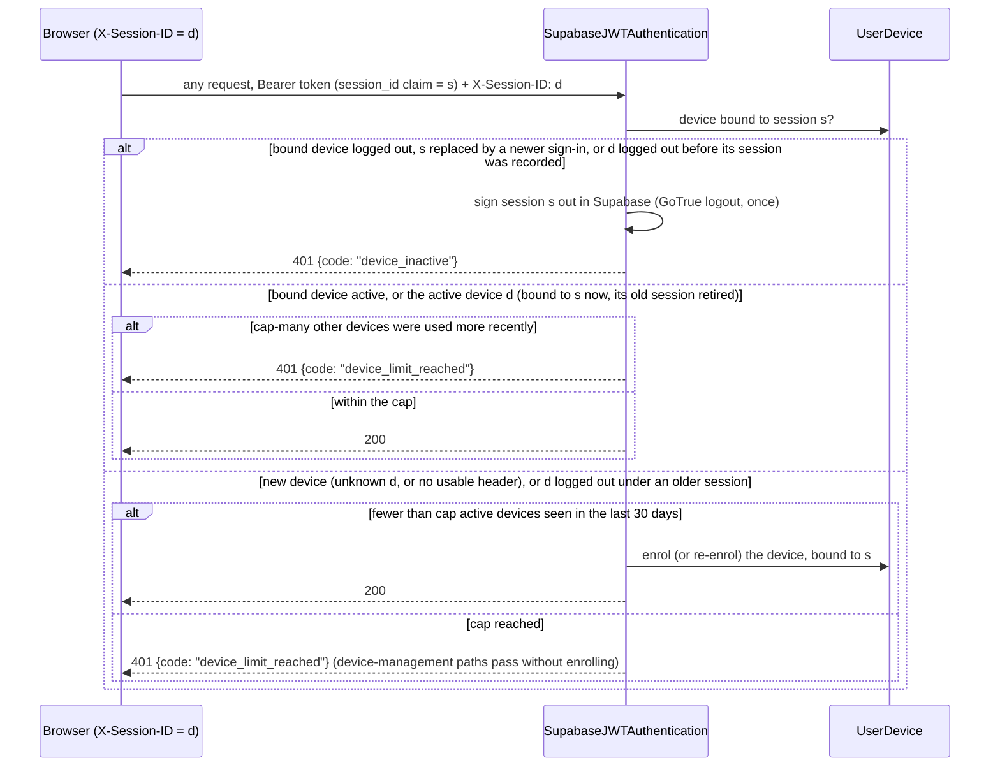
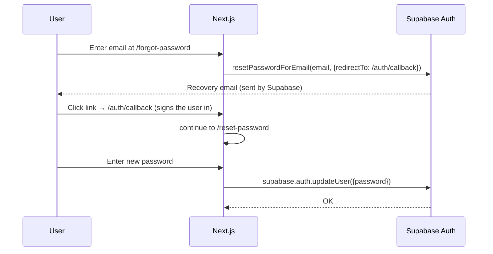
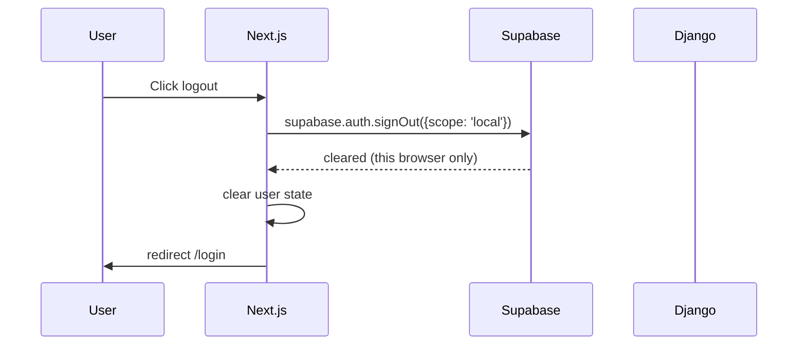

# Authentication & Authorization

> JWT / session flow, token refresh, role permissions, authorization model, security model, and protected routes.

---

## 0. Django-native sign-in (production since 2026-11-03)

Supabase is retired. Production runs with `AUTH_PROVIDER=django` (backend) and `NEXT_PUBLIC_AUTH_MODE=django`
(frontend); the Supabase sections below describe the previous mode, which is still the code default.

* **Endpoints** (`accounts/native_auth.py`, 404 outside django mode): `POST /api/auth/native/login/`,
  `/refresh/`, `/logout/`, `/register/` (202; the account is created only from the emailed link),
  `/verify-email/`, `/resend-verification/`, `/password/` (change); `POST /api/auth/password-reset/` and
  `/password-reset/confirm/` (410 in supabase mode); `POST /api/auth/google/`, `/google/confirm-link/`,
  `POST|DELETE /api/auth/google/link/`; `GET /api/auth/config/`. Token bodies `{access, refresh, session_id, user}`,
  errors `{detail, code}`.
* **Sessions** (`accounts/native_sessions.py`, model `AuthSession`): one per sign-in; refresh tokens rotate and a
  reused old refresh token revokes the session; logout, password change / reset, device logout and blocking end
  sessions. Device limits (2 free / 4 subscribed) are unchanged (`accounts/device_limits.py`).
* **Existing users**: `manage.py import_supabase_auth --source-url <restore of the Supabase backup>` (dry run;
  `--apply --create-missing` to write) links every Django account to its Supabase user, imports bcrypt password
  hashes (`accounts/hashers.py`, verified and re-hashed to Argon2 on first sign-in; never for admin/staff) and
  Google identities (`accounts.UserIdentity`, matched on Google's `sub`). Idempotent; ids never change.
* **Google** (`accounts/google_identity.py`): ID token verified against `GOOGLE_OAUTH_CLIENT_IDS`; sign-in by `sub`
  only. An unknown `sub` whose email belongs to an existing account gets `409 google_link_required` and an emailed
  single-use link; admin/staff accounts are linked only by an operator (`409 account_link_required`).
* **Throttles / lockout**: per-IP and per-email scopes (`accounts/throttles.py`); axes locks per (username, IP).

## 1. Two-Layer Auth Model

CrackCMS signed users in with **Supabase Auth only** in production until 2026-11 (django mode above since). The local username/password endpoints (`/api/auth/register/`, `/login/`, `/password-reset/…`) answer `410 Gone`. A Django-JWT path exists only for local development (`LOCAL_DEV_AUTH=1`, which requires `DEBUG=True`; see [`LOCAL_DEVELOPMENT.md`](./LOCAL_DEVELOPMENT.md)):



---

## 2. Token Types

| Token | Source | TTL | Storage |
|---|---|---|---|
| **Supabase access token** | `signInWithPassword` | 1 hour (Supabase default) | HTTP-only cookie via `@supabase/ssr` |
| **Supabase refresh token** | `signInWithPassword` | 7 days (Supabase default) | HTTP-only cookie |
| **Django access JWT** | `/api/auth/local/login/` (local dev only) | 15 min (`JWT_ACCESS_TOKEN_LIFETIME_MIN`) | local session (dev) |
| **Django refresh JWT** | `/api/auth/local/login/` (local dev only) | 7 days (`JWT_REFRESH_TOKEN_LIFETIME_DAYS`) | local session (dev) |
| **Session device ID** | `frontend/src/lib/api.ts` | Persistent per browser | `crack_device_id` (cookie + localStorage), sent as `X-Session-ID` |
| **Password recovery link** | Supabase `resetPasswordForEmail` | Supabase default | Supabase email → `/auth/callback` → `/reset-password` |

---

## 3. JWT Flow (local development only)

`POST /api/auth/login/` is disabled (`410`). Django-issued JWTs are only used by the dev-only local auth (`accounts/local_auth.py`), mounted under `/api/auth/local/` when `settings.LOCAL_DEV_AUTH` is on; that setting is forced off whenever `DEBUG` is off, so the routes and `LocalDevJWTAuthentication` never exist in production.



**Settings** (`SIMPLE_JWT` in `crack_cms/settings.py`, env-overridable):
- `ACCESS_TOKEN_LIFETIME` = 15 minutes (`JWT_ACCESS_TOKEN_LIFETIME_MIN`)
- `REFRESH_TOKEN_LIFETIME` = 7 days (`JWT_REFRESH_TOKEN_LIFETIME_DAYS`)
- `ROTATE_REFRESH_TOKENS` = true (`JWT_ROTATE_REFRESH_TOKENS`)
- `BLACKLIST_AFTER_ROTATION` = only when `rest_framework_simplejwt.token_blacklist` is installed (it is not)

---

## 4. Supabase Flow (preferred path)



**Why Supabase-first**:
- Modern auth UX (passwordless, OAuth, MFA)
- Hosted Postgres backup option
- Reduced Django auth code surface

**Fallback** (no Supabase env vars): `frontend/src/lib/supabase.ts::isSupabaseAuthEnabled()` returns false → `api.ts` skips Supabase JWT injection. Outside local development (§3) nobody can then sign in.

### 4.1 Supabase identity linking

Sign-ins are matched by `CustomUser.supabase_uid` (migration `accounts.0023`), the Supabase user id; the email is not used for matching once a row is linked. The authenticator (`accounts/supabase_rest_auth.py`):

1. Refuses an identity without an email (`401 email_required`) or with an unconfirmed email (`401 email_not_confirmed`).
2. Looks the row up by `supabase_uid`. On an identity's **first** sign-in it links the local row that has the same (confirmed) email, or creates a new row. A row already linked to another identity is never re-linked by email (`401 account_link_required`).
3. Links an **admin / staff / superuser** row automatically only when
   - the identity is a trusted admin: Supabase `app_metadata` `role=admin` / `is_admin` (settable only with the service-role key), or an address on `CONTROL_TOWER_ADMIN_EMAILS` / `BOOTSTRAP_ADMIN_EMAIL`; or
   - the row was created from this identity: Supabase `created_at` ≤ `date_joined` + 5 minutes, and the email is confirmed.

   Otherwise the request gets `401 {code: "account_link_required"}` and the frontend signs out with "This account must be verified by an administrator before it can sign in". Automatic links of privileged rows are logged and written to the admin audit log.
4. A linked identity whose confirmed email changes in Supabase is followed (unless another account uses the address). A linked **student** whose Supabase email changes to an allowlisted admin address is **not** promoted and keeps its local email; grant admin in the admin panel or with `app_metadata` instead.
5. `user_metadata` is user-editable and never grants admin. Existing admins are never demoted here, and only trusted sources grant `is_superuser`.

**Runbook — once after deploying `accounts.0023`** (every existing row starts with an empty `supabase_uid`; `build.sh` prints the dry-run report on each deploy, it never applies):

```bash
python manage.py link_supabase_identity --all-privileged           # dry run: report every unlinked admin/staff row
python manage.py link_supabase_identity --all-privileged --apply   # link the original identities
# one account:
python manage.py link_supabase_identity --email admin@example.com [--uid <supabase-user-id>] [--replace] --apply
```

It applies the sign-in rule: an admin/staff row is linked only to the Supabase identity the row was created from. Rows whose identity was created **after** the account joined, or has no creation date, are reported as `CHECK` and skipped, because that is what a sign-up with an admin's address looks like while "Confirm email" is off. Confirm each such owner out of band, then link it with `--email <address> --apply` (it prints the same warning), or in bulk with `--all-privileged --include-newer-identities --apply` once every `CHECK` row is confirmed. Without `--uid` the id is looked up with the Supabase admin API (needs `SUPABASE_URL` and `SUPABASE_SERVICE_ROLE_KEY`; exactly one confirmed Supabase user must have the email). Every link is logged (logger `accounts.link_identity`) and audit-logged with `original_identity` true / false / null (null for an explicit `--uid`).

### 4.2 Required Supabase and backend settings

- **Supabase → Authentication → Sign In / Providers → Email: "Confirm email" ON and "Secure email change" ON.** Linking and the admin email allowlist trust the email Supabase reports as confirmed. With "Confirm email" off GoTrue marks every sign-up as confirmed, and with "Secure email change" off an email change needs no confirmation from the old address, so anyone could claim an address they do not own. The backend cannot read this setting: once both are on, set `SUPABASE_EMAIL_CONFIRMATION_ENABLED=true`. Until then `manage.py check --deploy` reports `accounts.W001`.
- **`SUPABASE_ANON_KEY`** (or `SUPABASE_PUBLISHABLE_KEY` / `SUPABASE_AUTH_VERIFY_KEY`; the same public key as the frontend's `NEXT_PUBLIC_SUPABASE_ANON_KEY`) is sent as `apikey` when verifying tokens. Without it the service-role key is used (`accounts.W002`), and without either every Supabase sign-in fails.
- **`CORE_DATA_BACKUP_PATH`** must point at a persistent volume in production, or the admin Backup / Restore data endpoints answer `503 {code: "backup_not_configured"}` (`accounts.W003`). `manage.py backup_core_data --output PATH` / `restore_core_data --input PATH` still work.

### 4.3 Usernames (public handles)

`CustomUser.username` is public: discussion threads, the leaderboard, a question's `verified_by_username` and topic notes' `created_by_username` show it, never a first / last name or the email (`crack_cms.public_names.public_handle`, `analytics.views._public_name`). A username that still shows the email address (an `@`, or the email's local part with an optional `_<n>` suffix) is shown as no name (`null`, or `""` in those string fields).

- **New accounts** (Supabase first sign-in, the dev-only local register) keep the username chosen at sign-up (Supabase `user_metadata.username`, or the local register's `username`) only when it passes the Settings rules: 3–30 characters of `[A-Za-z0-9_.]`, at least one letter or digit, not the email or its local part, not a name reserved for the team. Only a trusted admin identity (Supabase `app_metadata` or the env allowlist, §4.1) may keep a team name. A taken name gets `_2`, `_3`, … within 30 characters. Every other account (no name given, as with Google OAuth, or a refused name) gets a generated `learner_<8 hex>` handle (`accounts/handles.py`). The email's local part is never used.
- **Changing it**: learners pick another handle in Settings (`PATCH /api/auth/profile/`: the same rules, unique ignoring case, at most 10 changes an hour; see [`API_REFERENCE.md`](./API_REFERENCE.md#put--patch-apiauthprofile)).
- **Backfill**: migration `accounts.0027_rename_email_derived_usernames` gives every student account whose username shows its email a generated handle, the same as `python manage.py rename_email_derived_usernames --apply`; admin, staff and superuser accounts are skipped, and the renames cannot be reverted. The command (dry run unless `--apply`) reports what is left, e.g. accounts created by the previous release while this one deployed, and lists the skipped admin / staff ids.
- **Why renaming is safe**: sign-ins match `supabase_uid`, then the confirmed email (`user_metadata.username` is read only when the account is created); JWTs (dev-only local auth) carry the user id; django-axes lockouts only apply to the Django admin and the dev-only local password forms.

---

## 5. Token Refresh Strategy

### Frontend (`api.ts`)

The Supabase client refreshes its session internally. In addition, on a `401` the Axios response interceptor refreshes the Supabase session **once** and retries the request with the new token. The refresh is bounded (`frontend/src/lib/sessionRefreshGate.ts`: one refresh at a time, a cooldown, and no refresh for a token a refresh just produced), so a backend that rejects a valid session cannot drive a refresh loop. Session-ending codes (§11) are handled before this step, because a fresh token does not change those answers. In local-dev mode the interceptor calls `POST /api/auth/local/refresh/` instead.

---

## 6. Device Limit (2 free / 4 subscribed)

A user may be signed in on up to **2 devices on a free plan and 4 with an active subscription**. The 4-device cap follows an active `Subscription` row (`accounts.utils.is_premium`), not the `CustomUser.is_subscribed` flag. Sessions are not limited to one device; the old `CustomUser.session_key` / `current_session_id` fields are unused, and `session_invalid` is no longer emitted.



**Mechanism** (`accounts/supabase_rest_auth.py::_enforce_device_limits`):
- A device is a browser bound to the Supabase auth session that uses it. `UserDevice.device_fingerprint` is the `X-Session-ID` header (`crack_device_id`, generated by `api.ts`); `UserDevice.session_id` (migration `accounts.0025`) is the `session_id` claim of the verified access token, which the client can neither omit nor forge. Header values that do not look like a device token (UUID, `dev_…` / `ses_…`, or 16–128 safe characters) are ignored, so enumerating ids cannot multiply devices.
- The session binding is looked up first. A logged-out or replaced session gets `device_inactive` whatever header it sends or omits, and its Supabase session is ended through GoTrue `POST /auth/v1/logout?scope=local` (best effort, once per session).
- A session without a usable header is a device of its own (fingerprint `sid:<session id>`) and takes a slot. Only a token without a `session_id` claim (GoTrue always sets it) that also lacks a usable header is not tracked.
- Signing in again on the same browser keeps its slot: the device row moves to the new session and the old session is retired (kept as an inactive `sid:<session id>` row, never listed), so one device id is one seat at a time. A fresh sign-in on a logged-out browser is re-enrolled if a slot is free. A device logged out before its session was recorded gets `device_inactive`; the browser then signs in with a fresh device id.
- A **new** device is enrolled only while the user has fewer active devices than the cap among those seen in the last 30 days (older devices stay listed in Settings but no longer hold a slot).
- After a 4 → 2 downgrade, the most recently used devices keep their slots (judged on `last_login` before the current request). `last_login` is refreshed at most once a minute.
- An over-limit device may still call `/auth/profile/`, `/auth/devices/…`, `/auth/subscribe/…` and the read-only `GET /auth/tokens/` and `GET /analytics/announcements/`; these never enrol it. That lets it open Settings and remove a device, or buy the 4-device plan on `/subscription`.
- Admins (`role='admin'`) are exempt from device tracking.
- `GET /api/auth/devices/` lists active devices with `is_current` (true for the row resolved from the request's Supabase session, else the row of its `X-Session-ID`); `POST /api/auth/devices/logout/ {device_id}` logs one out.

**Frontend** (`frontend/src/lib/api.ts`, `deviceLimit.ts`): `device_limit_reached` keeps the session and opens `/settings?deviceLimit=1`, except while the user is already on `/settings` or `/subscription`. A `device_inactive` answer to a request that still carried an older session's token (another tab, a request in flight during a sign-in) is retried once with the current token; otherwise `device_inactive` drops the stored device id and signs out, so the next sign-in enrols a fresh device.

---

## 7. Roles & Permissions

### Role hierarchy

```
Anonymous
  └── Authenticated (any CustomUser)
        └── Student (role='student')
              └── Admin (role='admin')          # additional privileges
                    └── Superuser (is_superuser) # Django admin + every endpoint
```

### Permission matrix

| Capability | Anonymous | Student | Admin | Superuser |
|---|---|---|---|---|
| View landing, register, login | ✓ | ✓ | ✓ | ✓ |
| Use question bank | ✓ (limited) | ✓ | ✓ | ✓ |
| Use AI tutor / explain | — | ✓ (token-metered) | ✓ (bypassed) | ✓ (bypassed) |
| Purchase tokens / subscribe | — | ✓ | ✓ | ✓ |
| Create bookmark / flashcard / note | — | ✓ (own) | ✓ | ✓ |
| Submit feedback | — | ✓ | ✓ | ✓ |
| Receive feedback reward (+2 tokens) | — | ✓ | ✓ | ✓ |
| Django admin (`/admin/`) | — | — | partial | ✓ |
| Admin token grant/transfer | — | — | ✓ | ✓ |
| Admin user block / role change | — | — | ✓ | ✓ |
| System reset attempts / analytics | — | — | ✓ | ✓ |
| Backup / restore data | — | — | ✓ | ✓ |
| Run RAG knowledge scan | — | — | ✓ (`is_staff`) | ✓ |
| Send campaigns | — | — | ✓ | ✓ |
| Read audit log | — | — | ✓ (all) | ✓ (all) |
| Adjust weak-topic thresholds | — | — | ✓ | ✓ |

The REST admin endpoints use `accounts.permissions.IsControlTowerAdmin`: `role='admin'` **or** `is_superuser`. Platform-wide system actions (`scope=all`) also need `confirm: "RESET ALL"`.

### Enforcement

| Layer | Implementation |
|---|---|
| View-level | DRF `permission_classes`: `IsAuthenticated` (default), `IsControlTowerAdmin`, `IsAdminUser` (Django admin-style `is_staff` gate, e.g. knowledge scan, Import Center) |
| Object-level | DRF `get_queryset()` filters by `request.user` |
| Authenticator | `SupabaseJWTAuthentication`: blocked accounts (`account_blocked`), identity linking (§4.1), device limit (§6) |
| Middleware | `django-axes` brute-force lockout |
| Frontend | `useAuth()` hook reads `AuthProvider`; `api.ts` attaches token. Admin pages decide access from the **backend profile** (`GET /api/auth/profile/` → `role` / `is_admin`), see §8. |

---

## 8. Protected Routes (Frontend)

| Route | Auth required | Role |
|---|---|---|
| `/`, `/login`, `/register`, `/forgot-password`, `/reset-password` | No | — |
| `/dashboard` | Yes | Any |
| `/questions` | Yes (read preview OK) | Any |
| `/ai-tutor`, `/generate`, `/roadmap` | Yes | Any |
| `/flashcards`, `/tests`, `/simulator`, `/bookmarks`, `/analytics`, `/trends` | Yes | Any |
| `/tokens`, `/subscription` | Yes | Any |
| `/settings` | Yes | Any |
| `/leaderboard`, `/jobs`, `/feedback`, `/contact` | Yes | Any |
| `/textbooks`, `/resources`, `/upload` | Yes | Any |
| `/study-time`, `/quests`, `/mistake-notebook` | Yes | Any |
| `/admin` | Yes | Admin |

The frontend `middleware.ts` (`src/utils/supabase/middleware.ts`) redirects signed-out visitors of protected paths to `/login?next=<path + query>`. For `/admin` it only checks that the visitor is signed in: the admin role is checked by the page itself against the **backend profile** (`role` / `is_admin` from `/api/auth/profile/`; every admin page and layout sends non-admins to `/dashboard`, e.g. `useRequireAuth({ requireAdmin: true })`) and by every admin API. Supabase `user_metadata`, which a student can edit with `supabase.auth.updateUser`, is never trusted; the Supabase-only mapping in `auth.tsx` (allowlisted confirmed email or `app_metadata`) is a fallback used only when the backend profile is unavailable.

---

## 9. Security Model

### Defense layers (outermost first)

1. **TLS** (Vercel + Render terminate HTTPS; production: HSTS 1 year, include subdomains, preload, SSL redirect).
2. **CORS**: `CORS_ALLOWED_ORIGINS` restricted to `https://cracklabs.app` (prod; also accepts the Vercel alias `https://crack-me-ai1.vercel.app`). Custom headers: `x-session-id` added to defaults.
3. **Security headers** (`vercel.json` + Django): `X-Content-Type-Options`, `X-Frame-Options=DENY`, `Referrer-Policy=strict-origin-when-cross-origin`, `Permissions-Policy`, `SECURE_BROWSER_XSS_FILTER=True`.
4. **CSRF**: Django CSRF middleware on session endpoints; JWT/Supabase endpoints use Bearer auth (CSRF-immune). `CSRF_COOKIE_HTTPONLY=True`, `CSRF_TRUSTED_ORIGINS` configured.
5. **Authentication**: `accounts.supabase_rest_auth.SupabaseJWTAuthentication` (primary) + `SessionAuthentication` fallback.
6. **Authorization**: per-view DRF permission classes (`IsAuthenticated`, `IsAdminUser`, `IsControlTowerAdmin`).
7. **Brute-force**: `django-axes` — 5 failed attempts → 30 min lockout per `[username, ip_address]`. Resets on success.
8. **Device limit**: `UserDevice` rows keyed by `X-Session-ID` and bound to the access token's Supabase session, 2 devices free / 4 with an active subscription (`device_limit_reached`, `device_inactive`; §6).
9. **Rate limiting** (verified from `settings.py`):
   - DRF: `AnonRateThrottle` 120/min, `UserRateThrottle` 600/min, `ScopedRateThrottle admin_control_tower` 180/min, `ai_tutor` 30/min
   - Custom: `questions.middleware.RateLimitMiddleware` — `QUESTION_BANK_RATE_LIMIT` (default 300) GETs per `QUESTION_BANK_RATE_WINDOW` (60 s) on `/api/questions/`, per user or, when anonymous, per client IP
   - Client IP behind proxies: set `NUM_PROXIES` (DRF throttles and the limiter) and, on DigitalOcean, `TRUSTED_CLIENT_IP_HEADER=DO-Connecting-IP` (limiter only); check with `GET /api/health/client-ip/` as an admin. Unset, every anonymous request shares the proxy's bucket.
   - Supabase token verification (runs before the DRF throttles): a per-process cap on concurrent GoTrue calls and, once the client IP is known, a per-IP budget; over either the answer is `429 auth_verification_busy` (§12).
   - AI provider-level: Groq 30 RPM, Gemini 15 RPM, etc.
10. **AI error filtering**: `_PROVIDER_ERROR_PHRASES` prevents provider-internal error text from reaching users.
11. **Sentry**: unhandled exception capture (when `SENTRY_DSN` set).
12. **Audit trail**: `AdminAuditLog` append-only.
13. **Database startup guards**: production refuses to run without `DATABASE_URL`; SQLite LFS pointer detection.

### Threat model summary

| Threat | Mitigation |
|---|---|
| Credential stuffing | `django-axes` lockout |
| Token theft | HTTP-only cookies (Supabase path); short TTL (1 h Supabase access token) |
| Account sharing | Device limit (2 free / 4 subscribed, §6) |
| Account takeover by email | Identity linked by `supabase_uid`; privileged rows link only to their original identity (§4.1); Supabase "Confirm email" + "Secure email change" required (§4.2) |
| Privilege escalation | DRF permission classes + `is_staff` checks |
| CSRF | Bearer auth on write endpoints; CSRF on Django session endpoints |
| Open redirect | Only `FRONTEND_URL` is used for email links; every post-sign-in `?next=` (`/login`, `/auth/callback`, and the path `auth.tsx` remembers across an OAuth / magic-link round trip) goes through `safeInternalPath` (`frontend/src/lib/auth-redirect.ts`). Only same-origin paths pass: the value must start with a single `/`; control characters, whitespace, back-slashes, doubled separators and `:` are rejected; it is resolved with the URL parser and must keep the site origin, and its canonical path (path + query + hash) is what gets used |
| AI provider error leakage | `_PROVIDER_ERROR_PHRASES` filter |
| Mass token drain | Rate limits + token balance check + provider rotation |
| SQL injection | Django ORM parameterized queries |
| XSS | React auto-escapes by default; no `dangerouslySetInnerHTML` in user content paths |
| Secret leak | `.gitignore` excludes `.env`; pre-commit `secret-scan` hook |

---

## 10. Session Lifecycle

```
┌─────────────────┐
│  Anonymous       │
└────────┬────────┘
         │ Supabase sign-up / sign-in
         ▼
┌─────────────────┐
│  Authenticated   │   ← first request: CustomUser created or linked (supabase_uid), TokenBalance seeded
└────────┬────────┘
         │ UserDevice enrolled for the browser (X-Session-ID), bound to the Supabase session (within the 2 / 4 device cap)
         ▼
┌─────────────────┐
│  Active session  │   ← X-Session-ID + Bearer token
└────────┬────────┘
         │ logout / expire / 401
         ▼
┌─────────────────┐
│  Anonymous       │
└─────────────────┘
```

### Token TTLs & reset policies

| Token | Reset trigger | Reset value |
|---|---|---|
| Daily free tokens | Midnight local | `daily_tokens_used = 0` |
| Weekly free tokens | Monday 00:00 local | `weekly_tokens_used = 0` |
| Purchased tokens | Never | n/a |
| Feedback credits | Never | n/a |
| Django access JWT (local dev only) | 15 min | `/api/auth/local/refresh/` |
| Django refresh JWT (local dev only) | 7 days | Re-login |
| Supabase access | 1 hour | Auto-refresh |
| Supabase refresh | 7 days | Re-login |
| Device slot | Device unseen for 30 days, or logged out in Settings / by an admin | Slot freed for a new device |

---

## 11. Frontend Auth Wiring

### `lib/auth.tsx` (`AuthProvider`)
- Reads Supabase session on mount, then loads the backend profile (`GET /api/auth/profile/`); that profile is the user object (role, `is_admin`, subscription). `mapSupabaseUser()` (allowlisted confirmed email or `app_metadata`, never `user_metadata`) is only a fallback while the backend profile is unavailable.
- Exposes `useAuth()` hook with `{ user, isAdmin, isAuthenticated, login, logout, refresh }`

### `lib/supabase.ts`
- `getSupabaseBrowserClient()` — lazily constructs the browser client
- `isSupabaseAuthEnabled()` — checks env vars (`NEXT_PUBLIC_SUPABASE_URL`, `NEXT_PUBLIC_SUPABASE_ANON_KEY`)
- `isInvalidRefreshTokenError()` — detects refresh-token rotation failures
- `clearSupabaseLocalSession()` — clears cookies + storage

### `lib/api.ts` request interceptor
```typescript
api.interceptors.request.use(async (config) => {
  config.headers['X-Session-ID'] = getOrCreateSessionId();
  if (isSupabaseAuthEnabled()) {
    const { data } = await getSupabaseBrowserClient().auth.getSession();
    config.headers.Authorization = `Bearer ${data.session?.access_token}`;
  }
  return config;
});
```

### `lib/api.ts` response interceptor (order of checks)
1. **`auth_verification_busy`** (429) — retried once after `Retry-After` (at most 2 s). Safe for every method: the answer comes from authentication, before any view runs.
2. **`device_inactive` for a request sent with an older session's token** (another tab, a request in flight during a sign-in) — retried once with the current session's token before anything is signed out.
3. **Session-ending codes** — `account_blocked`, `email_not_confirmed`, `email_required`, `account_link_required`, `device_inactive` (and the legacy `user_inactive` / `session_invalid`): `endSessionAfterApiError()` clears the session (and, for `device_inactive`, the device id) and redirects to `/login?authError=<message>` (not when already on `/login`, so the form can show the error).
4. **`device_limit_reached`** — keeps the session and opens `/settings?deviceLimit=1`, unless the page is `/settings` or `/subscription` (`deviceLimit.ts`).
5. **`upgrade_required`** (402) — opens the global upgrade modal with `feature` / `remaining` / `cap`.
6. **401** — one bounded session refresh and retry (§5).
7. **502/503/504** — idempotent requests (GET / HEAD / OPTIONS) are retried once on `FALLBACK_API_BASE_URL`; a POST is never replayed.

---

## 12. Backend Auth Wiring

### `accounts/supabase_rest_auth.py` — `SupabaseJWTAuthentication` (first in `DEFAULT_AUTHENTICATION_CLASSES`)
- Reads `Authorization: Bearer …` and verifies it with Supabase `GET /auth/v1/user` (`apikey` = the public key, §4.2). DRF authenticates before its throttles run, so every bearer value reaches this check; it is bounded by these verification limits (each value a Django setting or an environment variable of the same name):
  - **Pre-check**: a value that cannot be a live access token (not a JWT, `alg` `none`, no `sub`, no `exp` or one 10 s or more in the past, over 16,384 characters) is refused locally, without a call.
  - **Caches** (key: SHA-256 digest of the whole token; the `rate_limit` cache alias, else `default`): a valid answer is cached for `SUPABASE_TOKEN_CACHE_SECONDS` (default 300) and never past the token's `exp`; a token GoTrue refused (a 4xx other than 408 / 429) is not checked again for 60 s.
  - **One shared call**: concurrent requests with the same token in one process wait for a single GoTrue call.
  - **Concurrency cap**: at most `SUPABASE_AUTH_MAX_CONCURRENT_VERIFICATIONS` GoTrue calls at a time per process (default 2; 0 = no cap).
  - **Per-IP budget**: `SUPABASE_AUTH_VERIFY_RATE_PER_IP` GoTrue calls per client IP per minute (default 240, applied only once `TRUSTED_CLIENT_IP_HEADER` or `NUM_PROXIES` is set, since until then every request carries the proxy's address; 0 = off).
  - **Timeout**: `SUPABASE_AUTH_TIMEOUT_SECONDS` (default 3 s).
  - Over the cap or the budget the request is answered `429 {"detail": "...", "code": "auth_verification_busy"}` with `Retry-After: 1`, without a call; a request waiting on a shared call gets the same answer when that call hit a limit or did not finish within the timeout + 1 s. `api.ts` retries once (§11).
- Resolves / links / creates the `CustomUser` (§4.1) and seeds its `TokenBalance`
- Rejects blocked accounts (`account_blocked`) and enforces the device limit (§6); failures are `401` with a machine-readable `code`
- Answers `WWW-Authenticate: Bearer realm="api"`, so expired tokens are `401` (not `403`) and the frontend's refresh-on-401 runs

### `accounts/middleware.py`
- `UpdateLastSeenMiddleware` only: refreshes `CustomUser.last_seen` at most every 5 minutes. It does no session or device checks.

### `accounts/permissions.py`
- `IsControlTowerAdmin` — authenticated and (`is_admin`, i.e. `role='admin'`, or `is_superuser`). Used by every REST admin endpoint.

### `accounts/checks.py`
- Deploy checks `accounts.W001` (Supabase email confirmation not acknowledged), `W002` (no public verify key), `W003` (`CORE_DATA_BACKUP_PATH` unset); see §4.2.

### `accounts/supabase_auth.py`
- Service-role helpers for the Supabase admin API (e.g. `list_supabase_auth_users`, used by `link_supabase_identity`).

---

## 13. Password Reset Flow



The Django endpoints `POST /api/auth/password-reset/` and `/password-reset/confirm/` are disabled (`410 {error: "endpoint_gone"}`): the old Django uid/token mail could never work with the `/reset-password` page and set a password no login path uses. Signed-in users are not redirected away from `/reset-password` (the recovery link signs them in first).

**Email backend selection** (`crack_cms/settings.py`, used for the backend's own mails such as the welcome email):
```python
if EMAIL_HOST_PASSWORD and EMAIL_HOST_PASSWORD.strip():
    EMAIL_BACKEND = 'django.core.mail.backends.smtp.EmailBackend'
else:
    EMAIL_BACKEND = 'django.core.mail.backends.console.EmailBackend'
```

See [`setup/EMAIL_SETUP.md`](./setup/EMAIL_SETUP.md) for Gmail App Password configuration.

---

## 14. Logout



There is no Django logout endpoint. `scope: 'local'` ends only this browser's session (the default `global` scope would sign out every device although 2–4 are allowed). The device keeps its `UserDevice` slot until it is removed in Settings (`POST /api/auth/devices/logout/`) or unseen for 30 days.
